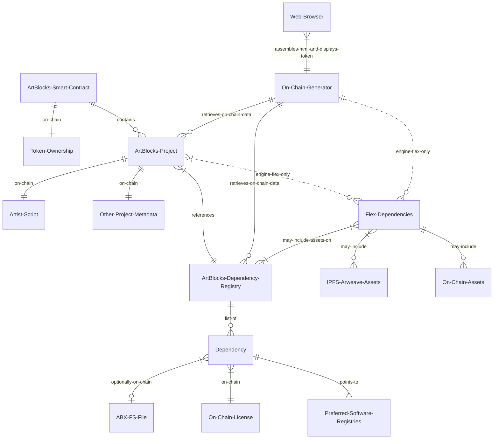
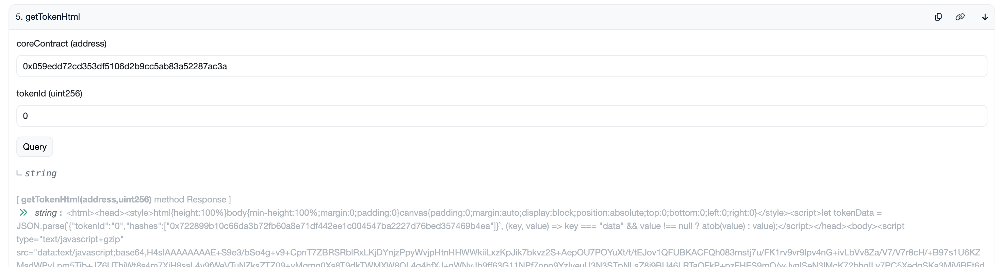
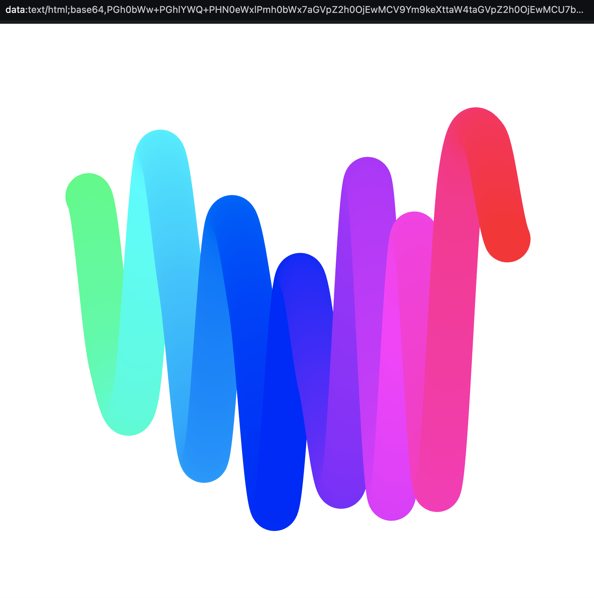
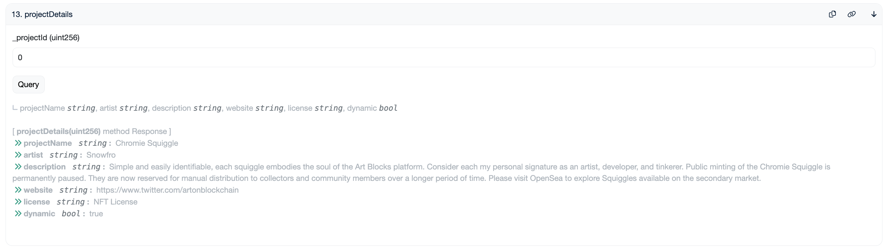
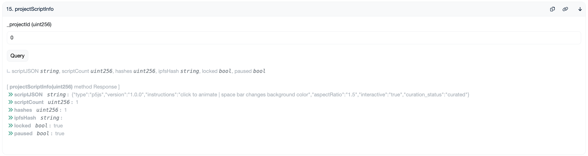
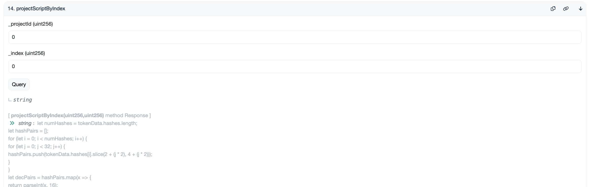
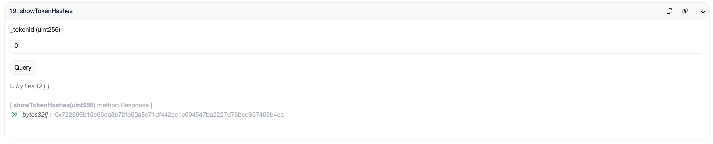

# NFT Metadata Storage at Art Blocks

An overview of NFT metadata storage philosophy and implementations at Art Blocks.

## Summary

Art Blocks tokens store their metadata fully on-chain, ensuring collectors that their NFTs will always remain accessible and immutable.

Token outputs are assembled on-chain by the Art Blocks On-Chain Generator, which retrieves the token's script and dependencies from the blockchain and assembles them into an HTML document that can be viewed in a web browser.

For projects that require dependencies (e.g. p5js), Art Blocks provides the [Art Blocks Dependency Registry](https://github.com/ArtBlocks/artblocks-contracts/blob/main/packages/contracts/README.md#dependencyregistry), a fully on-chain software registry that points each dependency release at its on-chain copy on [ABX FS](https://docs.fs.abx.io), as well as at preferred software storage networks.

Art Blocks Engine Flex is a more capable contract variant that supports additional dependency types — including IPFS/Arweave decentralized storage, multiple Dependency Registry entries, BytecodeStorage, and PostParams — in addition to fully on-chain storage.

## Overview of NFT Metadata Storage Options

While all NFTs track token ownership on a blockchain, the metadata for the NFT (image or audio information, artist information, etc.) may be stored in a variety of ways. Common options include:

| Storage Type                                                    | Immutable | Decentralized | Guaranteed to Persist Forever [^1] | Cost   |
| --------------------------------------------------------------- | --------- | ------------- | ---------------------------------- | ------ |
| [Servers/Hosting](#servershosting)                              | No        | No            | No                                 | Low    |
| [Hash On-Chain](#hash-on-chain)                                 | Yes       | No            | No                                 | Low    |
| [Decentralized Storage Network](#decentralized-storage-network) | Yes       | Yes           | No [^2]                            | Medium |
| [Fully On-Chain](#fully-on-chain)                               | Yes       | Yes           | Yes                                | High   |
| [Software Registry](#software-registries)                       | ~Yes [^3] | ~Yes          | No, Very Low Risk                  | Low    |

[^1]: As long as the blockchain network continues to exist.
[^2]: Requires ≥1 interested party
[^3]: Typically hash of release is published to prevent tampering/changes

### Servers/Hosting

The metadata are stored on a server or cloud hosting service, such as AWS. This is a convenient and cheap option, but it has a few drawbacks:

- The metadata can be changed by the server owner, so the NFT is not immutable.
- The metadata can be lost if the server goes down or an admin decides not to discontinue paying for the service.
- The metadata can be censored by the server owner.

### Hash On-Chain

The hash of the metadata is stored on-chain, and the metadata is stored on a server. Storing the hash of the metadata makes the NFT immutable, while keeping it much cheaper than storing all of the metadata on-chain. However, it has a few drawbacks:

- The metadata can be lost if the server goes down or an admin decides not to discontinue paying for the service.
- The metadata can be censored by the server owner.

Projects such as CryptoPunks originally stored the hash of the metadata on-chain, but the metadata was stored on a server. They have since upgraded to a fully on-chain solution.

### Decentralized Storage Network

The metadata are stored on a decentralized storage network, such as IPFS or Arweave. This is a popular option, and enables the NFT to be immutable. Drawbacks include:

- The metadata must remain pinned by at least one party in order to be accessible.

### Fully On-Chain

The metadata are stored on the blockchain. This is the most expensive option, but it has many advantages. The metadata are always accessible and available, as long as the NFT exists. Collectors and artists never have to worry about a token's outputs disappearing.

### Software Registries

Some NFTs (like some Art Blocks project tokens) may rely on published software libraries when generating outputs. In these cases, the NFT metadata may include information about dependencies and where to find them (e.g. "p5js, v1.0.0 on the cdnjs software registry"). Software registries are a special form of decentralized storage, because of the distributed nature of the software repositories and many downloads on developers' computers worldwide.

## Art Blocks Storage Solutions

### Art Blocks Fully On-Chain

Art Blocks Flagship and Art Blocks Engine NFTs only rely on fully on-chain storage solutions, plus allowing a single dependency to be housed on a software registry. This provides an extremely high level of confidence that the NFTs will remain fully accessible and immutable for the foreseeable future.

The **[Art Blocks Dependency Registry](https://github.com/ArtBlocks/artblocks-contracts/blob/main/packages/contracts/README.md#dependencyregistry)** is a fully on-chain software registry used by all Art Blocks Flagship NFTs. A dependency is on chain when the registry records its **ABX FS file**: the library's code, gzip-compressed and stored on [ABX FS](https://docs.fs.abx.io), Art Blocks' permissionless, immutable on-chain file system. Every library used by the first 500 Art Blocks Curated projects is stored this way, so those projects can always generate their outputs from the blockchain alone, without relying on any CDN.

### Engine Flex

Engine Flex is the more capable Engine contract variant. Flex projects can be fully on-chain — identical to standard Engine — or they can incorporate additional dependency types: multiple Dependency Registry entries, IPFS or Arweave decentralized storage for large assets, BytecodeStorage for on-chain byte arrays, and PostParams for on-chain configurable parameters that collectors can adjust after minting. These capabilities are opt-in per project and can be combined in any way.

## Examples

## On-Chain Generator Example

Let's review an example of how to retrieve the html that allows your browser to view the output of the first Art Blocks Token, token zero of project 0, [Chromie Squiggle by Snowfro](https://www.artblocks.io/marketplace/asset/0x059edd72cd353df5106d2b9cc5ab83a52287ac3a/0).

1. Visit the Art Blocks On-Chain Generator on Etherscan: [0x953D288708bB771F969FCfD9BA0819eF506Ac718](https://etherscan.io/address/0x953D288708bB771F969FCfD9BA0819eF506Ac718#readProxyContract)

2. Get the html for token 0 by calling the `getTokenHtml` function with the core contract address `0x059edd72cd353df5106d2b9cc5ab83a52287ac3a` and token ID `0` as the input parameters:

3. The returned text is the html that is used to generate the token's output. You can also copy and paste a base64-encoded version of this html in your browser to view the token's output! Use the function `getTokenHtmlBase64EncodedDataUri` to get the base64-encoded version of the html, and paste it into your browser's address bar to view the token's output.

This process of retrieving and viewing tokens is streamlined in our open source [on-chain generator viewer](https://github.com/ArtBlocks/on-chain-generator-viewer)

## On-Chain Script Example

Let's review an example of how to retrieve the token and script metadata for the first Art Blocks Token, token zero of project 0, [Chromie Squiggle by Snowfro](https://www.artblocks.io/collections/curated/projects/0x059edd72cd353df5106d2b9cc5ab83a52287ac3a/0).

> Note: Newer versions of Art Blocks core contracts have different function names than the V0 Art Blocks core contract shown in this example.

While we could query the Art Blocks Subgraph or API to retrieve the metadata, we will retrieve the metadata directly from the blockchain.

1. Visit the original Art Blocks Core Contract on Etherscan: [0x059EDD72Cd353dF5106D2B9cC5ab83a52287aC3a](https://etherscan.io/address/0x059EDD72Cd353dF5106D2B9cC5ab83a52287aC3a#readContract)
2. Get project 0's metadata by calling the `projectDetails` function with the project ID as the input parameter:

3. Get project 0's script details by calling the `projectScriptInfo` function with the project ID as the input parameter:

4. Get the script javascript by calling the `projectScriptByIndex` function with the project ID and index 0 as the input parameter. The returned text is the javascript code that is used to generate Chromie Squiggles!

5. Get token 0's token hash by calling the `showTokenHashes` function with the token ID as the input parameter. This is the hash that is injected into the script to generate the token's unique output.

## On-Chain Dependency Example

Let's review an example of how to retrieve the dependency metadata for the first Art Blocks Token, token zero of project 0, [Chromie Squiggle by Snowfro](https://www.artblocks.io/collections/curated/projects/0x059edd72cd353df5106d2b9cc5ab83a52287ac3a/0).

In this case, the project uses the p5js v1.0.0 dependency, which the Art Blocks Dependency Registry records as an ABX FS file. While we could query the Art Blocks Subgraph or API to retrieve the metadata, we will retrieve the metadata directly from the blockchain.

1. Visit the Art Blocks Dependency Registry on Etherscan: [0x37861f95882ACDba2cCD84F5bFc4598e2ECDDdAF](https://etherscan.io/address/0x37861f95882ACDba2cCD84F5bFc4598e2ECDDdAF#readProxyContract)

2. Get the dependency details by calling the `getDependencyDetailsV2` function with the dependency name and version as the input parameter. We translate from the string `p5@1.0.0` to its bytes32 representation `0x703540312e302e30000000000000000000000000000000000000000000000000`. `availableOnChain` is `true`, and `abxfsFileCid` is the dependency's ABX FS file: `0xd51a97d197e052299e2ef11718c4185435ea3d14ec04ec3276c807dc5d1654d0`.

3. Get the dependency code from ABX FS by its file CID. The file is the library gzip-compressed, which is exactly what the on-chain generator inlines into token HTML, where the page decompresses it before the project script runs. To read it:
   - **On chain:** call `readFileData` on the ABX FS `FileDataReader` ([0xb13D24967aB9B41787E2280D22d1d43a286c197a](https://etherscan.io/address/0xb13D24967aB9B41787E2280D22d1d43a286c197a#readContract)) with the CID and generous limits (for example `maxBytes` `10000000` and `maxChunks` `1000`). It returns the gzip bytes, labelled with their `codec` (`gzip`) and the `outputHash` of the decompressed library.
   - **In a browser:** open [fs.abx.io/g/cid/1/0xd51a97d1…](https://fs.abx.io/g/cid/1/0xd51a97d197e052299e2ef11718c4185435ea3d14ec04ec3276c807dc5d1654d0), which reads the same file from Ethereum and serves the library.

And that's it! We now have all of the information we need to generate the token's output, and we can be confident that the metadata will always be available and immutable!
